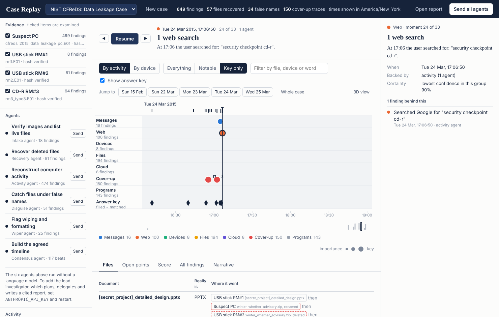

# Case Replay

Agents that rebuild what happened on seized devices, and a timeline an investigator, a prosecutor and a jury can all read.

Built at HackPrinceton Fall 2026 for the Arlequin AI track "AI-Driven Forensics".


*The real NIST case. One PowerPoint file starts on the company USB stick under its own name, is renamed to `winter_whether_advisory.zip` on the PC, is copied to a second stick that is later formatted, and ends on a CD-R from which it is then removed. Every stop is proven by hash or by a journal record.*

## The problem

A leak case arrives as disk images. Today an examiner runs separate tools for deleted files, file signatures, registry and browser history, then builds the timeline by hand in a spreadsheet. Three things go wrong:

1. **Keyword search misses the point.** A confidential slide deck renamed `winter_storm.amr` on a formatted USB stick matches no keyword.
2. **The timeline is not checkable.** By the time it reaches a prosecutor it is a slide. Nobody can click an event and see the bytes behind it.
3. **A jury cannot follow it.** Offsets and hive paths do not explain what the person did.

## What Case Replay does

You open a case, point it at the images and send out agents. Each agent has one job:

| Agent | Job | How |
|---|---|---|
| Intake | Verify each image, list what it shows today | SHA-1 against the published hash, volume detection, hash and true type of every live file |
| Recovery | Bring back deleted files | FAT32 directory clusters that survive a quick format, stale entries from an earlier format, deleted exFAT entry sets, every past state of a write-once disc, structure-aware carving |
| Disguise | Catch files under false names | Extension against real content (looks inside ZIP and OLE containers), identical content across devices, and the computer's own rename records to reveal the original name |
| Wiper | Flag evidence destruction | Quick-format detection and dating, traces of erasers and cleaners, the rename-then-delete pattern of secure erasers in the NTFS journal |
| Activity | Rebuild what the user did on the computer | USB history, searches, downloads, program runs, installs, shortcuts, browsed folders, cloud sync log, email, and the NTFS change journal, read straight from the disk image |
| Consensus | Put everything on one clock | Groups findings into story beats, follows each file across devices, counts how many agents back each beat, lists what does not add up |

On top sits a **lead investigator built with LangChain deepagents**. It plans the work, delegates to the specialists with the `task` tool, reads the consensus and writes a cited report.

The design rule is simple: **the model proposes and explains, the tools compute, the ledger proves.**

- Every finding carries evidence pointers: image, path, byte offset, length, SHA-256, and the recovered file itself.
- The lead agent can only cite finding ids that exist. `write_report` rejects a report with an unknown id or no citation.
- Anything the lead infers beyond a single artifact is stored as "awaiting review" until a person confirms or rejects it.
- Without an API key the same six agents still run. Only the planning and the prose need a model.

## The timeline

- Rows by activity or by device. Colour is the kind of activity. Size is importance.
- **Replay** steps through the case one moment at a time with a plain-language caption.
- **Follow this file** draws one document's path across devices, under every name it carried.
- Click anything to see the evidence behind it, download the recovered file, and confirm or reject the finding.
- **Open report** gives a printable account with an exhibit list: every notable finding with its image, offset and hash.
- Tick evidence items to send agents to specific devices only.
- **3D view** puts device across, activity up and time in depth, with quiet gaps folded so the camera flies from burst to burst.



## Run it

Needs Python 3.11 or newer.

```bash
./run.sh
```

That builds a small synthetic practice case, runs every agent on it and opens the app at http://127.0.0.1:8000.

### The NIST Data Leakage Case

The reference dataset is the public [NIST CFReDS Data Leakage Case](https://cfreds-archive.nist.gov/data_leakage_case/data-leakage-case.html): one Windows 7 PC image, two USB sticks and one CD-R.

```bash
bash scripts/fetch_dataset.sh --small   # three removable-media images, about 410 MB
bash scripts/fetch_dataset.sh           # adds the PC image, 7.3 GB
./run.sh                                # the NIST case appears in the case list
```

In the app choose "NIST CFReDS: Data Leakage Case" and press "Send all agents". From the command line:

```bash
./run.sh run nist-data-leakage          # run every agent, then print the score
./run.sh run nist-data-leakage --agents recovery,disguise --images rm2
./run.sh lead nist-data-leakage         # LLM lead investigator, needs ANTHROPIC_API_KEY
```

### Scoring

`eval/nist_ground_truth.json` is transcribed from the NIST answer key: 17 files on the formatted USB stick, 17 on the CD-R, 24 disguising renames and 44 timeline events. It is read only by `casereplay/score.py`. No agent or tool can reach it. The Score tab and `./run.sh score nist-data-leakage` report found over expected for each check and list what was missed.

## Results on the NIST Data Leakage Case

All four images, 8.2 GB, hash-verified against the values NIST publishes. Analysis takes about 40 seconds on a 4-core laptop VM with no GPU and no language model, plus about 40 seconds to hash the images.

| Check against the published answer key | Result |
|---|---|
| Evidence images match their published SHA-1 | 4 of 4 |
| USB stick RM#2: files recovered after the quick format, type correct | 17 of 17 |
| RM#2: recovered sizes agree with the answer key | 17 of 17 |
| RM#2: disguised files flagged with their true type | 17 of 17 |
| RM#2: quick format detected and dated inside the answer-key window | yes, 17:02:36 |
| CD-R RM#3: deleted documents recovered | 17 of 17 |
| PC: disguising renames recovered from the change journal | 24 of 24 |
| Timeline: answer-key events with a matching, evidenced finding | 42 of 44 |

The two timeline misses: the name of an email attachment (the mailbox keeps only a quote of that message, without the attachment), and the resignation letter, which we date 18 minutes later than the reference time we transcribed.

What the agents found that a keyword search would not:

- **The formatted stick.** All 17 confidential documents came back intact from directory clusters that survived the format. Each carried a media or text extension. Each was traced to its original name twice: by content hash against the company stick, and by the rename record in the PC's change journal.
- **Two independent clocks for the format.** The new volume label on the stick says 17:02:36. The PC's registry shows the same label returning with a new volume serial number at 17:02:34.
- **An earlier life of the same stick.** 22 older files were recovered by fitting stale directory entries to an earlier format with 16 KB clusters.
- **The CD-R replayed second by second.** A disc written with a live file system keeps every past allocation table. Reading all nine gives each state of the disc with its time: 17 files burned at 16:55:47, five folders renamed between 16:56:14 and 16:56:39, three filler pictures added at 16:57:03, the 17 files removed from the directory at 16:58:15. All 17 were recovered by name, including one stored in two fragments that carving alone can only get partly.
- **A Recycle Bin that was emptied and wiped.** The journal still records 16 items being moved into it, and 10 files being overwritten by Eraser.
- **Email that was deleted.** Five messages no longer in the mailbox were recovered from the quotes inside later replies, including the one that carries the Google Drive share links.
- **A document opened straight from the company stick.** A deleted Office lock file on the stick dates it to 14:37:52 and names the user.

The full account, generated without a language model and with every line citing its findings, is in [docs/nist-case-narrative.md](docs/nist-case-narrative.md).

## What is real and what is synthetic

- **Practice case (synthetic).** "Halcyon Robotics, Project Kestrel" is invented. The images are generated by `casereplay/synth.py`, but they are real file systems: a quick-formatted FAT32 stick, an exFAT stick with a deleted entry, a write-once UDF disc with an old and a new directory. The workstation activity in this case comes from a generated triage export, not from a disk image.
- **NIST case (public data).** Real images from NIST. Nothing about it is stored in this repo except the published hashes and the answer key transcription used for scoring.

## Honest limits

- Reading Outlook mailboxes needs the optional `libpff-python` package. `run.sh` tries to install it. Without it, email is skipped and the log says so. Attachments are not extracted.
- Recovery after a format assumes files were stored contiguously, which holds for files copied onto a fresh stick. Every recovered file is validated by its content afterwards.
- Disc history needs a UDF disc with a virtual allocation table (a "live file system" disc). Other discs are read as a single state, with carving as the fallback.
- On the PC, deleted files are reported from the change journal and the Recycle Bin. Their content is not carved from the NTFS volume.
- The answer key was transcribed by hand into `eval/nist_ground_truth.json`. Two reference times could not be re-checked against the PDF.
- The lead investigator (the LLM layer) is tested with a scripted model. It has not been run with a real model on the NIST case yet.

## How it maps to the judging criteria

- **Analytical depth.** Content over names: container-aware type detection, cross-device identity by hash, disc history from allocation tables, an earlier disk layout inferred from stale entries, format dating from two independent sources, wipe detection from journal rename bursts, deleted email recovered from quotes.
- **Technical implementation.** Pure Python, read-only, deterministic and re-runnable. 15 tests: an end-to-end run, a scripted deep-agent run, and cross-checks against file systems written by standard tools (mkfs.vfat, mtools, genisoimage) rather than by our own generator.
- **Usefulness.** Case tracking, agent dispatch, human review of every finding, recovered files one click away, a printable narrative with citations.
- **Visualization and demo.** Interactive timeline, file threads, replay, 3D view.
- **Responsible compute.** The forensic work uses no model at all. The LLM only plans and writes, over a few kilobytes of ledger JSON.

A two-minute demo script is in [docs/DEMO.md](docs/DEMO.md).

## Layout

```
casereplay/
  images.py fat32.py exfat.py udf.py carve.py magic.py docmeta.py   forensic engine
  examiners/   inventory, recovery, disguise, wipers, activity      one module per agent
  consensus.py   timeline, beats, file journeys, cautions
  pipeline.py    dispatch and task tracking
  agents.py      deepagents lead investigator and specialists
  score.py       scoring against the answer key
  server.py      FastAPI app
  synth.py       practice case generator
web/             timeline UI (vanilla JS, d3, three.js)
eval/            NIST ground truth
tests/
```

## Credits

Dataset: NIST Computer Forensic Reference Data Sets (CFReDS), Data Leakage Case. Image parsing: the [dissect](https://github.com/fox-it/dissect) framework by Fox-IT. Agents: [deepagents](https://github.com/langchain-ai/deepagents) by LangChain.
