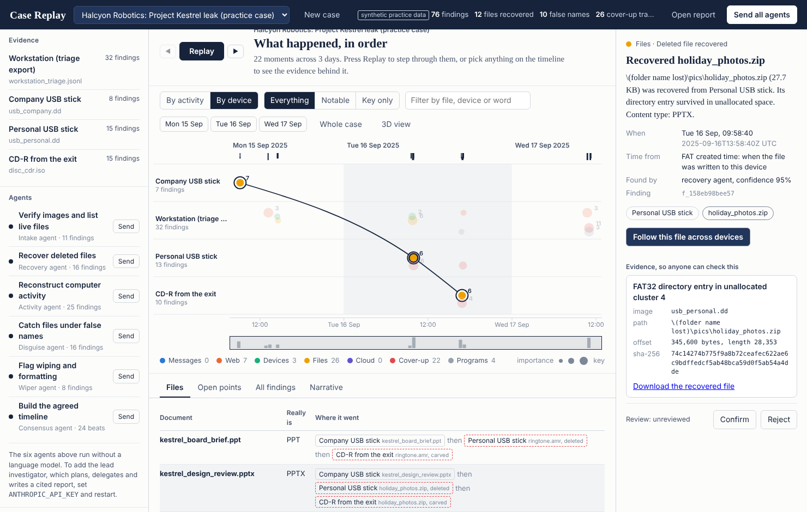

# Case Replay

Agents that rebuild what happened on seized devices, and a timeline an investigator, a prosecutor and a jury can all read.

Built at HackPrinceton Fall 2026 for the Arlequin AI track "AI-Driven Forensics".



## The problem

A leak case arrives as disk images. Today an examiner runs separate tools for deleted files, file signatures, registry and browser history, then builds the timeline by hand in a spreadsheet. Three things go wrong:

1. **Keyword search misses the point.** A confidential slide deck renamed `winter_storm.amr` on a formatted USB stick matches no keyword.
2. **The timeline is not checkable.** By the time it reaches a prosecutor it is a slide. Nobody can click an event and see the bytes behind it.
3. **A jury cannot follow it.** Offsets and hive paths do not explain what the person did.

## What Case Replay does

You open a case, point it at the images and send out agents. Each agent has one job:

| Agent | Job | How |
|---|---|---|
| Intake | Verify each image, list what it shows today | SHA-1 against the published hash, volume detection, hash and true type of every live file |
| Recovery | Bring back deleted files | FAT32 directory clusters that survive a quick format, deleted exFAT entry sets, old UDF directories on write-once discs, structure-aware carving |
| Disguise | Catch files under false names | Extension against real content (looks inside ZIP and OLE containers), then matches identical content across devices to reveal the original name |
| Wiper | Flag evidence destruction | Quick-format detection and dating, traces of erasers and cleaners, the rename-then-delete pattern of secure erasers in the NTFS journal |
| Activity | Rebuild what the user did on the computer | USB history, searches, downloads, program runs, installs, Recycle Bin, shortcuts, change journal, read straight from the disk image |
| Consensus | Put everything on one clock | Groups findings into story beats, follows each file across devices, counts how many agents back each beat, lists what does not add up |

On top sits a **lead investigator built with LangChain deepagents**. It plans the work, delegates to the specialists with the `task` tool, reads the consensus and writes a cited report.

The design rule is simple: **the model proposes and explains, the tools compute, the ledger proves.**

- Every finding carries evidence pointers: image, path, byte offset, length, SHA-256, and the recovered file itself.
- The lead agent can only cite finding ids that exist. `write_report` rejects a report with an unknown id or no citation.
- Anything the lead infers beyond a single artifact is stored as "awaiting review" until a person confirms or rejects it.
- Without an API key the same six agents still run. Only the planning and the prose need a model.

## The timeline

- Rows by activity or by device. Colour is the kind of activity. Size is importance.
- **Replay** steps through the case one moment at a time with a plain-language caption.
- **Follow this file** draws one document's path across devices, under every name it carried.
- Click anything to see the evidence behind it, download the recovered file, and confirm or reject the finding.
- **3D view** puts device across, activity up and time in depth, with quiet gaps folded so the camera flies from burst to burst.


## Run it

Needs Python 3.11 or newer.

```bash
./run.sh
```

That builds a small synthetic practice case, runs every agent on it and opens the app at http://127.0.0.1:8000.

### The NIST Data Leakage Case

The reference dataset is the public [NIST CFReDS Data Leakage Case](https://cfreds-archive.nist.gov/data_leakage_case/data-leakage-case.html): one Windows 7 PC image, two USB sticks and one CD-R.

```bash
bash scripts/fetch_dataset.sh --small   # three removable-media images, about 410 MB
bash scripts/fetch_dataset.sh           # adds the PC image, 7.3 GB
./run.sh                                # the NIST case appears in the case list
```

In the app choose "NIST CFReDS: Data Leakage Case" and press "Send all agents". From the command line:

```bash
./run.sh run nist-data-leakage          # run every agent, then print the score
./run.sh run nist-data-leakage --agents recovery,disguise --images rm2
./run.sh lead nist-data-leakage         # LLM lead investigator, needs ANTHROPIC_API_KEY
```

### Scoring

`eval/nist_ground_truth.json` is transcribed from the NIST answer key: 17 files on the formatted USB stick, 17 on the CD-R, 24 disguising renames and 44 timeline events. It is read only by `casereplay/score.py`. No agent or tool can reach it. The Score tab and `./run.sh score nist-data-leakage` report found over expected for each check and list what was missed.

## What is real and what is synthetic

- **Practice case (synthetic).** "Halcyon Robotics, Project Kestrel" is invented. The images are generated by `casereplay/synth.py`, but they are real file systems: a quick-formatted FAT32 stick, an exFAT stick with a deleted entry, a write-once UDF disc with an old and a new directory. The workstation activity in this case comes from a generated triage export, not from a disk image.
- **NIST case (public data).** Real images from NIST. Nothing about it is stored in this repo except the published hashes and the answer key transcription used for scoring.

## Honest limits

- Mailbox parsing (Outlook OST) is not implemented, so email events from the answer key will show as missed.
- Recovery after a format assumes files were stored contiguously, which holds for files copied onto a fresh stick. Every recovered file is validated by its content afterwards.
- The UDF reader is a sector scanner for write-once discs. It does not follow the virtual allocation table, so on some discs names and content are matched by carving and hashing instead.
- NTFS deleted-file recovery on the PC is limited to what the Recycle Bin and the change journal record.

## How it maps to the judging criteria

- **Analytical depth.** Content over names: container-aware type detection, cross-device identity by hash, format dating from the volume label entry, wipe detection from journal rename patterns.
- **Technical implementation.** Pure Python, read-only, deterministic and re-runnable. 9 tests, including an end-to-end run and a scripted deep-agent run.
- **Usefulness.** Case tracking, agent dispatch, human review of every finding, recovered files one click away, a printable narrative with citations.
- **Visualization and demo.** Interactive timeline, file threads, replay, 3D view.
- **Responsible compute.** The forensic work uses no model at all. The LLM only plans and writes, over a few kilobytes of ledger JSON.

## Layout

```
casereplay/
  images.py fat32.py exfat.py udf.py carve.py magic.py docmeta.py   forensic engine
  examiners/   inventory, recovery, disguise, wipers, activity      one module per agent
  consensus.py   timeline, beats, file journeys, cautions
  pipeline.py    dispatch and task tracking
  agents.py      deepagents lead investigator and specialists
  score.py       scoring against the answer key
  server.py      FastAPI app
  synth.py       practice case generator
web/             timeline UI (vanilla JS, d3, three.js)
eval/            NIST ground truth
tests/
```

## Credits

Dataset: NIST Computer Forensic Reference Data Sets (CFReDS), Data Leakage Case. Image parsing: the [dissect](https://github.com/fox-it/dissect) framework by Fox-IT. Agents: [deepagents](https://github.com/langchain-ai/deepagents) by LangChain.
